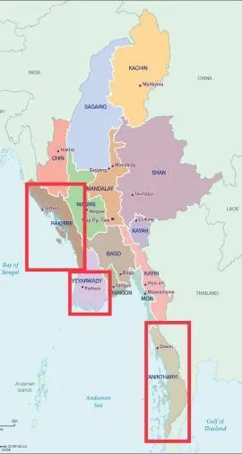

## Coastal States and Regions of Myanmar

Myanmar has several coastal regions that play a significant role in the country's economy and environment. These states and regions include:

- **Rakhine State** — Located on the western coast of Myanmar, bordered by the Bay of Bengal to the west, Chin State to the north, Magway, Bago and Ayeyarwady regions to the east, and the Chittagong Division of Bangladesh to the northwest. The state covers approximately 36,762 square kilometers and has a population of around 4 million.
- **Ayeyarwady Region** — Situated in the southern part of Myanmar, known for its fertile delta and extensive river systems. It is a major agricultural hub, producing rice and other crops.
- **Tanintharyi Region** — Located in the southernmost part of Myanmar, known for its beautiful beaches, islands, and rich biodiversity. It shares a border with Thailand to the east.

## Focus on Rakhine State

Rakhine State has a unique historical background and is known for its diverse ethnic groups, including Rakhine, Rohingya, Kamein, Chin, Mro, Thet, Kamin and others. The state's capital is Sittway, and it is home to several important towns and islands such as Ramree, Cheduba and Myingun. Despite being rich in natural resources, the state is one of the poorest in Myanmar.

### Key Features of Rakhine State

**Geography:** Rakhine State is separated from Burma Proper by the Rakhine Yoma, which rises to 3,063 meters at Victoria Peak. The state has a coastline along the Bay of Bengal, making coastal communities highly susceptible to cyclones and natural disasters.

**Economy:** The economy of Rakhine State is primarily based on agriculture — particularly rice, coconut and nipa palm — as well as fisheries, forestry, timber and bamboo. The state also has potential for tourism, with attractions like Mrauk-U and Ngapali Beach.

**Challenges:** Rakhine State faces many challenges, including an unstable political climate, communal violence, ethnic conflicts, natural disasters and poverty. The region was severely affected by Cyclone Mocha in 2023, which caused significant damage and displacement.

**Development Projects:** There are ongoing development and humanitarian projects in Rakhine State implemented by local organizations and INGOs, along with civil society networks and communities. Rakhine State also hosts several mega projects, such as the deep-sea port and Special Economic Zone in Kyaukphyu, and the Kaladan Multi-modal Transit Transport Project in Sittway.

Rakhine State's strategic location and rich natural resources make it an important region for Myanmar's development and economic growth.

## Tanintharyi Region

### Key Features of Tanintharyi Region

**Geography:** Tanintharyi Region is located in the southernmost part of Myanmar, bordered by the Andaman Sea to the west and Thailand to the east. The region covers approximately 43,344.9 square kilometers and includes the Mergui Archipelago, a group of over 800 islands.

**Economy:** The economy is primarily based on agriculture, fishing and forestry. Dawei, the regional capital, is the key economic hub, with ongoing development projects including a proposed Special Economic Zone.

**Tourism:** The region is known for its stunning natural beauty, including pristine beaches, lush forests and diverse wildlife. A significant number of popular islands and beaches attract tourists.

## Ayeyarwady Region

### Key Features of Ayeyarwady Region

**Geography:** Ayeyarwady Region is situated in the delta of the Ayeyarwady River, bordered by the Bay of Bengal to the south and west. It covers approximately 35,140 square kilometers and is known for its fertile alluvial plains.

**Economy:** Thanks to its fertile soil, the region is the main rice-producing area of Myanmar. Agriculture is the primary economic activity, with rice, pulses, and other crops being cultivated. Fisheries are the second-largest source of the region's economy.

**Challenges:** The region faces many challenges, especially conflicts over resource access between large holders and smallholders, and conflicts between fishers and fishing-lot (inn) owners. It is also vulnerable to natural disasters: the region was severely affected by Cyclone Nargis in 2008, which caused significant damage and loss of life. The region also faces challenges related to flooding, infrastructure development, and natural resource management.
